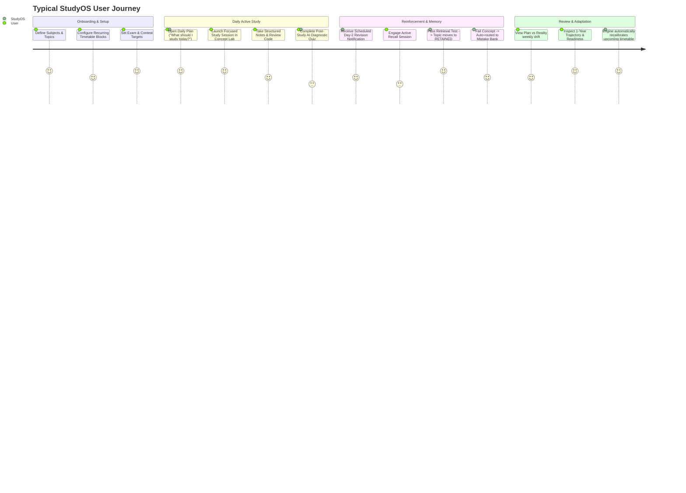
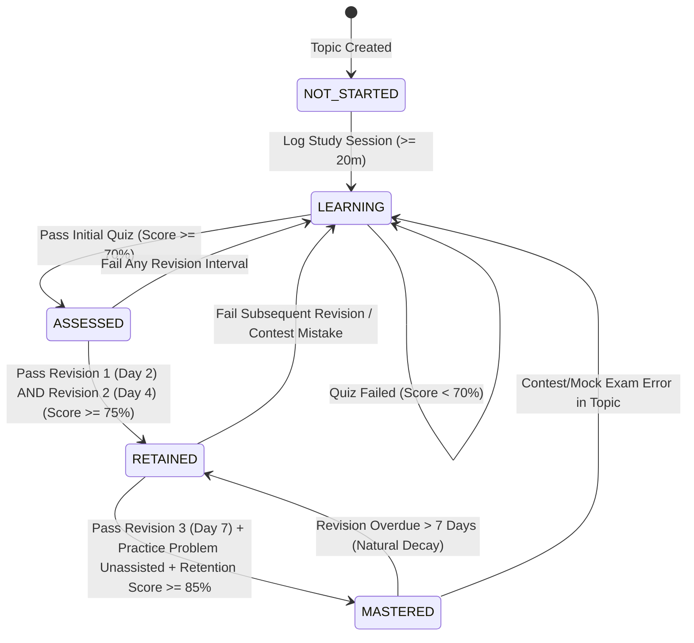
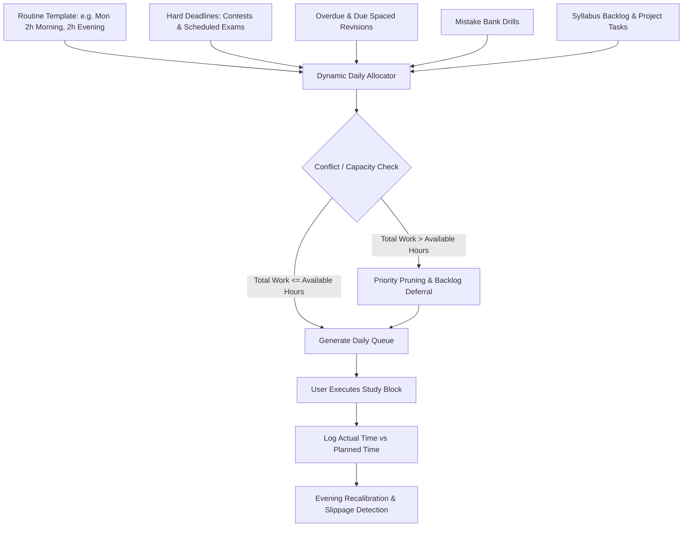
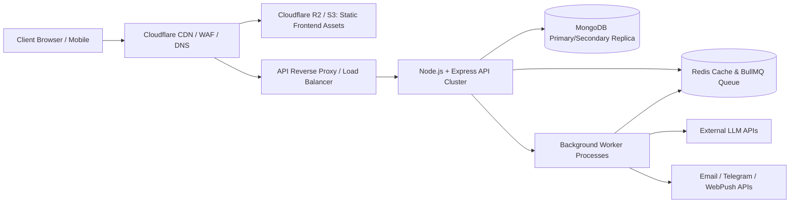
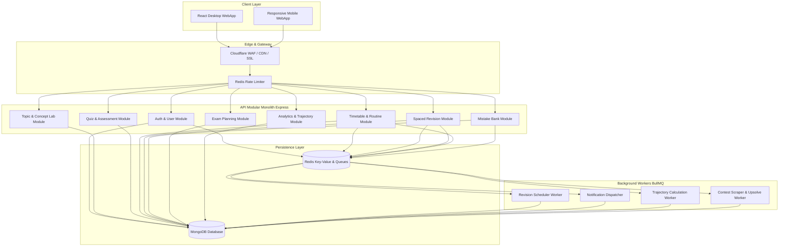
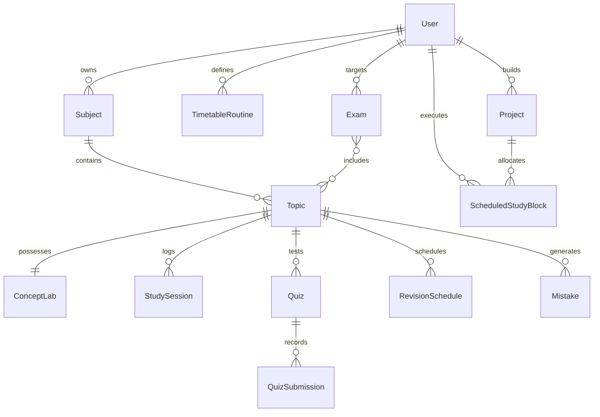
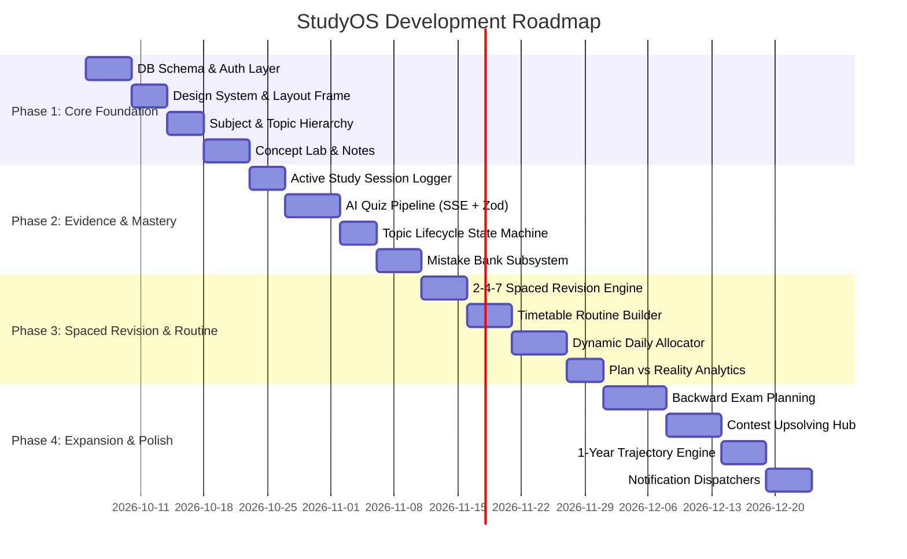

# StudyOS: Master Product & Technical Specification
**Document Version:** 1.0.0-PROD  
**Status:** Approved Architecture Draft / Source of Truth  
**Author:** Lead Product Architect & System Designer  
**Scope:** Complete Architectural, Technical, and Product Blueprint for Personal Learning Operating System  

---

## 1. Product Vision

StudyOS is an evidence-based **Personal Learning Operating System** designed for high-ambition self-directed learners, software engineers, and competitive students. 

Traditional productivity and learning applications suffer from the **"Checkbox Fallacy"**: a user creates a checklist of topics (e.g., *Dynamic Programming*, *System Design*, *Operating Systems*), ticks a box after skimming a video, and the application reports 100% completion. Weeks later, when faced with an interview, contest, or exam, the user experiences total cognitive retrieval failure.

StudyOS rejects manual self-certification. Its foundational law is:
> **"Learning progress must be derived from verifiable cognitive and behavioral evidence, not manual checkboxes."**

StudyOS treats knowledge acquisition as a continuous dynamic state that requires active input (focused study sessions), verification (retrieval quizzes, coding tests, debugging drills), scheduled reinforcement (decay-calibrated spaced revision), and stress testing (contests, mock exams, project implementation). It acts as an intelligent co-pilot that answers the daily question: *"What should I study right now to maximize long-term retention and hit my target goals?"*

---

## 2. Target User Profiles (Personas)

### Primary Persona: The High-Stakes Tech Candidate & Competitive Programmer ("Aryan")
- **Profile:** 3rd/4th-year CS student or working junior engineer preparing for Tier-1 software engineering interviews and LeetCode/Codeforces contests.
- **Pain Points:** 
  - Solves 200 LeetCode problems but forgets patterns solved 3 weeks ago.
  - Disorganized notes scattered across Notion, Obsidian, and random text files.
  - Can't gauge whether they are actually ready for interview loops.
  - Falls into the illusion of competence by reading solution editorials without active recall.
- **Needs in StudyOS:** Concept Lab for algorithms, deep Mistake Bank with categorization (e.g., off-by-one, greedy vs DP misclassification), contest upsolving integration, and spaced problem revision.

### Secondary Persona: The University / Professional Exam Aspirant ("Priya")
- **Profile:** Student or professional balancing university exams, certifications (e.g., AWS Solutions Architect), or competitive entrance tests with daily life.
- **Pain Points:** 
  - Cramming syllabus in the last 72 hours.
  - Poor syllabus weightage distribution.
  - High anxiety caused by uncertainty over syllabus coverage.
- **Needs in StudyOS:** Backward Exam Planning Engine, syllabus weightage breakdown, daily adaptive burn-down timetable, and diagnostic readiness indexes.

---

## 3. Core Problems Being Solved

1. **Illusion of Competence (Passive Learning Trap):** Reading or watching content creates familiarity, which the brain mistakes for mastery. StudyOS enforces active recall and retrieval testing before changing a topic's status.
2. **Ebbinghaus Memory Decay Without Systemic Recalibration:** Memories decay exponentially. Without a deterministic spaced revision engine, 70% of learned material vanishes in 48 hours.
3. **Static Calendar Brittleness:** Traditional Google Calendar or Notion schedules shatter when a user misses a single 2-hour study block. StudyOS implements an **Adaptive Dynamic Scheduler** that gracefully recalibrates backlogs without causing user despair.
4. **Disjointed Learning Artifacts:** Notes, practice problems, quiz scores, contest errors, and flashcards exist in separate silos. StudyOS unifies them under a single normalized **Topic Graph**.
5. **Lack of Honest Learning Projections:** Students don't know where their current habits will lead them in 12 months. StudyOS provides predictive trajectory modeling with actionable behavioral levers.

---

## 4. Product Principles

1. **Zero Unearned Status:** No topic reaches `ASSESSED`, `RETAINED`, or `MASTERED` without verifiable objective performance (quizzes passed, code executed, revisions cleared).
2. **Deterministic Over Magical:** Core scheduling, revision timing, and mastery scores must be 100% deterministic, transparent, and auditable. AI generates questions and assists evaluation, but the scoring formulas and state transitions are mathematical and explainable.
3. **Friction Where It Matters, Flow Where It Doesn't:** Low friction to log a study session or take quick notes; intentional friction (active recall challenge) before marking a revision as satisfied.
4. **Adaptive Resilience:** When life happens and routines break, the system does not shame the user with red failure walls; it recalculates the optimal path forward based on remaining time and highest-yield priorities.
5. **Data Sovereignty & Local Time Integrity:** Learning data belongs to the user, and all scheduling logic strictly respects the user's localized civil day boundaries.

---

## 5. Complete Feature Map

```
StudyOS
│
├── 1. Knowledge Architecture
│   ├── Subject Hierarchy (Subject -> Topic -> Subtopic)
│   ├── Concept Lab (Intuition, Complexity, Visualizer, Code, Notes)
│   ├── Personal Notes (Markdown, LaTeX, Code Blocks, Bi-directional tags)
│   └── Mistake Bank (Classification, Root Cause, Spaced Re-test)
│
├── 2. Evidence & Assessment Engine
│   ├── Active Study Session Logger (Focus timer, Heartbeat, Engagement verification)
│   ├── AI Quiz Generation (MCQ, Conceptual, Code Output, Debugging, Coding Challenge)
│   ├── Objective Scoring & Rubric Evaluator
│   └── Topic Lifecycle State Machine (NOT_STARTED -> LEARNING -> ASSESSED -> RETAINED -> MASTERED)
│
├── 3. Spaced Revision Engine
│   ├── Configurable 2-4-7 Cadence Engine
│   ├── Plug-and-Play Memory Model Interface (FSRS / SM-2 Ready)
│   ├── Active Recall Question Delivery
│   └── Dynamic Retention & Decay Index
│
├── 4. Scheduling & Routine Engine
│   ├── Recurring Routine Template (Weekday/Weekend time blocks)
│   ├── Dynamic Daily Allocation Engine ("What to study today")
│   ├── Plan vs Reality Tracker (Planned vs Actual Duration & Velocity)
│   └── Backward Exam Planning Engine (Syllabus weightage, Milestone distribution)
│
├── 5. Application & Execution Tracking
│   ├── Project Management (Milestones, Tasks, Code links, Logged hours)
│   └── Contest Tracker (LeetCode, Codeforces, Rating changes, Upsolving Queue)
│
├── 6. Analytics & Intelligence
│   ├── Focus & Retention Metrics (No vanity metrics)
│   ├── 1-Year Behavioral Trajectory Simulator (Monte Carlo / Linear Projection)
│   └── Actionable Improvement Levers
│
└── 7. Platform & Notification Services
    ├── Multi-Channel Dispatcher (In-app, Email, Telegram, Web Push)
    ├── Security & RBAC Guardrails
    └── Timezone-Aware Cron & Dispatch Workers
```

---

## 6. User Journey



---

## 7. Information Architecture

```
Root
│
├── /dashboard (Daily Mission Control, What to study today, Urgent revisions, Today's routine)
│
├── /topics
│   ├── /topics (Subject & Topic tree, Mastery breakdown)
│   └── /topics/:topicId (Concept Lab: Intuition, Notes, Visualizer, Quiz, Revision History)
│
├── /timetable
│   ├── /timetable/daily (Dynamic daily execution schedule)
│   ├── /timetable/routines (Recurring weekly routine manager)
│   └── /timetable/plan-vs-reality (Historical planned vs actual analytics)
│
├── /revisions
│   ├── /revisions/due (Pending spaced reviews queue)
│   └── /revisions/session/:id (Interactive active recall interface)
│
├── /mistakes
│   ├── /mistakes (Searchable, filterable mistake registry)
│   └── /mistakes/drill (Targeted practice on recurrent errors)
│
├── /exams
│   ├── /exams (Active exam roadmaps)
│   └── /exams/:examId (Backward plan, Syllabus burn-down, Readiness gauge)
│
├── /projects
│   ├── /projects (Active development projects)
│   └── /projects/:projectId (Milestones, Tasks, Timetable integration)
│
├── /contests
│   ├── /contests (Contest calendar, Performance logs, Rating graph)
│   └── /contests/upsolve (Unsolved problems linked to topics)
│
├── /analytics
│   ├── /analytics/overview (Deep focus hours, Retention stability, Subject health)
│   └── /analytics/trajectory (1-Year forecast, Sensitivity levers)
│
└── /settings
    ├── /settings/profile (Timezone, Locale)
    ├── /settings/notifications (Channel preferences, Quiet hours)
    └── /settings/algorithms (Spaced repetition parameters, Quiz difficulty)
```

---

## 8. Application/Page Map

| Page Identifier | URL Path | Primary Function | Key Interactive Components |
|---|---|---|---|
| **Mission Control** | `/dashboard` | Daily execution command center | "Study Now" CTA, Overdue Revision cards, Routine timeline, Plan-vs-Actual progress bar |
| **Concept Lab** | `/topics/:id/lab` | Deep conceptual mastery workspace | Code sandbox/viewer, Markdown editor, Visualizer canvas, Diagnostic quiz trigger |
| **Active Revision** | `/revisions/active` | High-focus spaced recall session | Flashcard flip, Code snippet bug hunt, Self-confidence rating, Immediate feedback |
| **Timetable Planner**| `/timetable` | Weekly template & daily allocation | Drag-and-drop routine block builder, Calendar sync view, Conflict detector |
| **Exam Strategist** | `/exams/:id` | Backward induction exam planner | Burn-down chart, Priority weight matrix, Daily topic quota assigner |
| **Mistake Vault** | `/mistakes` | Anti-failure learning repository | Root-cause filter (Syntax/Logic/Edge-Case), Re-test launcher, Resolution tagger |
| **Contest Hub** | `/contests` | Competitive programming ledger | Contest logger, Platform sync (LeetCode/Codeforces), Upsolve backlog |
| **Analytics Engine**| `/analytics` | Objective evidence metrics | Retention half-life curve, Subject mastery radar, 1-Year Monte Carlo projection |

---

## 9. Core User Flows

### Flow 1: New Topic Learning & Evidence Ingestion
1. User navigates to `/topics` and selects `Graph Algorithms` -> `Dijkstra's Algorithm`.
2. System loads `/topics/dijkstra/lab` displaying existing theory, pseudo-code, and personal notes.
3. User starts a **Study Session** (Timer starts; background sends heartbeat every 60s to ensure focus).
4. User writes notes and tests intuition. Finishes session after 45 minutes.
5. System prompts: *"Session recorded (45m). Take a 5-question diagnostic quiz to lock in baseline evidence?"*
6. User accepts: Server triggers AI Quiz Generation (2 conceptual, 1 edge-case, 1 time complexity, 1 output prediction).
7. User scores 4/5 (80%).
8. **Lifecycle Transition:** Topic state moves from `NOT_STARTED` -> `ASSESSED`.
9. **Spaced Revision Trigger:** Revision engine schedules **Revision 1** at `CurrentDate + 2 days`.

### Flow 2: Spaced Revision Execution & Failure Rerouting
1. On Day 2, user receives a morning notification: *"Revision due: Dijkstra's Algorithm"*.
2. User enters `/revisions/session/:id`.
3. System presents 3 active recall questions without revealing notes.
4. User fails Question 2 (Misapplies edge case on negative weights).
5. User scores 1/3 (33%).
6. **Result:** Revision marked `FAILED`.
7. **Lifecycle Impact:** Topic falls back to `LEARNING (NEEDS_REVISION)`.
8. **Mistake Bank Integration:** System automatically creates a Mistake record linked to `Dijkstra's Algorithm`, tagged with `EDGE_CASE_BLINDNESS`.
9. **Schedule Recalibration:** Next revision contracted to `Tomorrow (+1 day)` instead of progressing to Day 4.

---

## 10. Learning Lifecycle State Machine



### State Definitions & Rules
- **`NOT_STARTED`**: Topic exists in syllabus. Zero evidence recorded.
- **`LEARNING`**: User has engaged in study time, but has not demonstrated objective retrieval competence.
- **`ASSESSED`**: User has proven initial baseline comprehension via an objective quiz (Score $\ge 70\%$).
- **`RETAINED`**: User has successfully recalled the material over at least 2 distinct spaced intervals ($T+2$, $T+4$) with composite score $\ge 75\%$.
- **`MASTERED`**: User has completed the full spaced cycle (through Day 7+), solved practical application problems without hints, and maintained an empirical retention score $\ge 85\%$.
- **`DECAYING` (Dynamic Flag)**: Applied to any `RETAINED` or `MASTERED` topic when scheduled review is overdue by $> 48$ hours.

---

## 11. Evidence-Based Learning Model (Mathematical Formulation)

The system computes an auditable **Topic Mastery Index ($M_t \in [0, 100]$)** for each topic $t$:

$$M_t = w_c \cdot C_t + w_a \cdot A_t + w_r \cdot R_t + w_d \cdot D_t$$

Where:
- **Weights:** $w_c = 0.25$ (Comprehension), $w_a = 0.35$ (Application/Practice), $w_r = 0.30$ (Retention), $w_d = 0.10$ (Consistency/Duration).
- $\sum w = 1.00$.

### Component Formulations:

1. **Comprehension Score ($C_t \in [0, 100]$):**
   $$C_t = \frac{\sum_{i=1}^{N_q} (\text{Score}_i \times \text{Difficulty}_i)}{\sum_{i=1}^{N_q} \text{Difficulty}_i} \times \text{Penalty}_{\text{attempts}}$$
   *Difficulty ratings:* Easy = 1.0, Medium = 1.5, Hard = 2.0.  
   *Penalty for retries on same question:* $0.75^{\text{retries}}$.

2. **Application / Practice Score ($A_t \in [0, 100]$):**
   $$A_t = \min\left(100, \sum_{p \in \text{Problems}} \left( \text{BasePts}(p) \times (1 - 0.25 \times \text{HintsUsed}_p) \times \text{TimeEfficiencyFactor} \right)\right)$$

3. **Retention Score ($R_t \in [0, 100]$):**
   Modelled on the exponential memory decay curve:
   $$R_t = 100 \times e^{-\frac{\Delta t}{S_t}}$$
   Where $\Delta t$ is days elapsed since last successful recall, and $S_t$ is the **Memory Stability** factor:
   - Initial $S_t = 2.0$ days.
   - Upon successful review with grade $q \in [1, 5]$:
     $$S_{t,\text{new}} = S_{t,\text{prev}} \times \left(1 + 0.1 \times q \times \text{IntervalMultiplier}\right)$$
   - Upon failed review ($q < 3$):
     $$S_{t,\text{new}} = \max\left(1.0, S_{t,\text{prev}} \times 0.5\right)$$

4. **Consistency & Depth Score ($D_t \in [0, 100]$):**
   $$D_t = \min\left(100, \frac{\text{ActualActiveStudyMinutes}_t}{\text{TargetStudyMinutes}_t} \times 100\right)$$

---

## 12. Spaced Revision Engine Requirements

### The Initial "2-4-7" Protocol
The default revision scheduler enforces progressive spacing intervals:
- **Interval 0 (Creation):** Day 0 (Initial learning + Assessment).
- **Interval 1:** $\text{Day 0} + 2 \text{ days}$ ($\pm 12 \text{ hours}$ window).
- **Interval 2:** $\text{Date of Success 1} + 4 \text{ days}$.
- **Interval 3:** $\text{Date of Success 2} + 7 \text{ days}$.
- **Interval 4+ (Maintenance):** $\text{Date of Success 3} + 14 \text{ days}$, doubling up to max 60 days.

### Extensible Engine Architecture
The revision service must implement a strict Strategy pattern interface so that advanced algorithms (e.g. Free Spaced Repetition Scheduler - FSRS v4.5 or SM-2) can be activated without database refactoring:

```typescript
export interface IRevisionEngine {
  calculateNextSchedule(
    history: ReviewLog[],
    lastIntervalDays: number,
    performanceScore: number // 0 to 100
  ): {
    nextIntervalDays: number;
    newStability: number;
    newDifficulty: number;
    isPromoted: boolean;
  };
}
```

### Edge Cases Handled:
- **Belated Revision (User completes review 5 days late):** The engine does not credit the full spacing multiplier as if it were on time; it measures memory decay over the actual $\Delta t$. If the user passes after 5 days overdue, stability increases more aggressively because long-delayed successful retrieval indicates stronger neural encoding.
- **Premature Review:** If user manually reviews a topic before the scheduled date, interval is NOT advanced unless at least 60% of the scheduled interval has elapsed.

---

## 13. Quiz Engine Requirements

### AI Prompting & Schema Isolation
- Quizzes are generated server-side using structured LLM calls with strict JSON Schema / Zod validation.
- Prompts must forbid vague open-ended essay questions. Every question must have an unambiguous, objectively verifiable evaluation criteria.

### Supported Question Typologies:
1. **Multiple Choice (Single/Multi-select):** Includes distractor explanations for each option.
2. **Output Prediction:** Provides a deterministic code snippet; user must provide the exact console/return output.
3. **Bug Hunting / Debugging:** Code snippet containing 1 logical or edge-case bug; user must identify the line number and the exact failure mechanism.
4. **Time/Space Complexity Evaluation:** Complex algorithmic variant where user selects Big-O bounds with formal justification.
5. **Coding Challenge:** LeetCode-style problem with 3 public test cases and 3 hidden edge cases evaluated in a secure sandbox.

### Anti-Cheating & Integrity Guardrails:
- Randomized question/distractor ordering.
- Copy/paste detection logged as telemetry flag.
- Time limit per question (default: 90 seconds for MCQ, 5 minutes for debugging).
- Retries on identical questions do not overwrite comprehension score without a decay factor applied.

---

## 14. Timetable / Scheduling Engine Requirements

### The Dynamic Adaptive Pipeline
The timetable is **not** a dumb Google Calendar. It is a real-time constraint satisfaction solver.



### Allocation Priority Hierarchy (Strict Order):
1. **Priority 1 (Inflexible Hard Events):** Scheduled Live Contests, School/Work fixed commitments.
2. **Priority 2 (High Decay Risk):** Overdue Spaced Revisions ($R_t < 60\%$).
3. **Priority 3 (Exam Imminent Milestones):** Topics on an exam syllabus where $\text{DaysToExam} < 14$.
4. **Priority 4 (Due Spaced Revisions):** Normal scheduled 2-4-7 revisions for the day.
5. **Priority 5 (Mistake Bank Remediation):** Recurring mistakes flagged for re-test.
6. **Priority 6 (New Topic Learning):** Backlog topics aligned with user weekly goals.
7. **Priority 7 (Project Development):** Open project tasks and milestones.

### Plan vs Reality Tracking:
For every scheduled block:
- Record `planned_start`, `planned_duration_minutes`.
- Record `actual_start`, `actual_duration_minutes`, `active_focus_minutes` (excluding idle).
- Compute **Daily Execution Ratio**:
  $$\text{Execution Ratio} = \frac{\sum \text{actual\_focus\_minutes}}{\sum \text{planned\_duration\_minutes}}$$
- If Execution Ratio $< 0.70$ for 3 consecutive days, trigger **"Schedule Burnout Alert"** and prompt the user to reduce daily routine quotas by 20%.

---

## 15. Exam Planning Logic (Backward Induction)

### Backward Scheduling Algorithm
Given an exam at date $T_{\text{exam}}$:

1. **Calculate Available Study Inventory:**
   $$\text{Total Hours Available} = \sum_{d = \text{Today}}^{T_{\text{exam}}} \text{UserAvailableHours}(d)$$
2. **Calculate Syllabus Workload:**
   $$\text{Total Required Hours} = \sum_{s \in \text{Syllabus}} \left( \text{BaseHours}(s) \times \text{Weightage}(s) \times (1.5 - 0.5 \times \text{CurrentMastery}(s)) \right)$$
3. **Feasibility Index:**
   $$\Phi = \frac{\text{Total Hours Available}}{\text{Total Required Hours}}$$
   - If $\Phi < 1.0$: System alerts: *"Syllabus unachievable at current daily pace. Deficit: X hours. Recommend increasing daily study by Y minutes or descoping low-weightage topics."*
4. **Milestone Phase Division:**
   - **Phase 1: Deep Ingestion (Today to $T - 21$ days):** Allocate new topic learning + Day 2/4 revisions.
   - **Phase 2: Consolidation ($T - 21$ to $T - 7$ days):** Zero new topics allowed. Mandatory Day 7 revisions, heavy practice, mistake bank clearance.
   - **Phase 3: High-Fidelity Simulation ($T - 7$ to $T - 2$ days):** Full-length mock exams, timed retrieval drills.
   - **Phase 4: Taper & Mental Priming ($T - 2$ to $T$ days):** Light formula recall, high-yield summary review.

---

## 16. Project + Contest Integration

### Competitive Programming Subsystem
- **Supported Platforms:** LeetCode, Codeforces, AtCoder, HackerRank.
- **Event Model:** 
  - Tracks contest date, platform, rank, rating delta, problems attempted vs solved.
- **The Upsolving Protocol:**
  - Any contest problem attempted but not solved during the live window is **automatically ingested** into the user's `Upsolving Queue`.
  - The problem cannot be removed from the queue until the user submits an accepted solution, tags the core concept to a StudyOS Topic, and logs the root-cause failure in the Mistake Bank.

### Project Tracking Subsystem
- **Structure:** Project -> Milestones -> Tasks -> Linked Commits/PRs.
- **Timetable Binding:** Project milestones can be assigned specific weekly routine blocks (e.g. "Saturday 4-hour Dev Sprint").
- **Evidence Cross-Pollination:** When a user completes a project milestone requiring a specific technology (e.g. "Implement Redis Caching Layer"), this is cross-referenced as application evidence for the `System Design: Caching` topic.

---

## 17. Mistake Bank (The Anti-Failure Engine)

Every mistake is treated as a high-value signal.

### Mistake Schema Taxonomy:
- **`mistake_id`**: UUID.
- **`topic_id`**: Reference to Topic.
- **`origin`**: `[QUIZ, CODING_PRACTICE, SPACED_REVISION, CONTEST, PROJECT_BUG]`.
- **`question_prompt` / `problem_url`**: Exact context.
- **`user_attempt`**: Erroneous code, answer choice, or written deduction.
- **`correct_solution`**: Verified solution with explanation.
- **`root_cause_category`**:
  - `CONCEPTUAL_GAP` (Did not understand theoretical mechanism)
  - `EDGE_CASE_BLINDNESS` (Null input, off-by-one, overflow, empty graph)
  - `EXECUTION_SLIP` (Typo, misread prompt, inverted boolean under time pressure)
  - `TIME_COMPLEXITY_EXCEEDED` (Suboptimal algorithm chosen)
  - `PATTERN_MISIDENTIFICATION` (Applied incorrect algorithmic archetype)
- **`one_line_rule`**: Mandatory user-written synthesis ("*Always check if $k=0$ before dividing by window size*").
- **`recurrence_count`**: Number of times this mistake pattern has been repeated.
- **`resolution_status`**: `[ACTIVE, PROBATION, RESOLVED]`.
  - A mistake enters `RESOLVED` only after user passes **2 consecutive surprise re-tests** separated by at least 5 days.

---

## 18. Analytics Requirements

The platform rejects vanity metrics (e.g., "Total page visits", "Account streak with 0 minutes studied").

### High-Signal Core Metrics:
1. **Active Focus Hours:** Verified time spent actively interacting with material (heartbeat checked, idle periods excluded).
2. **Retrieval Resilience Index:** Ratio of passed spaced revisions to total scheduled spaced revisions.
3. **Mastery Velocity:** Net topics promoted to `RETAINED` or `MASTERED` per week.
4. **Mistake Liquidation Rate:** Percentage of Mistake Bank entries successfully moved from `ACTIVE` to `RESOLVED`.
5. **Plan Adherence Index:** Ratio of actual completed study blocks matching planned topics.
6. **Subject Health Radar:** Multi-axial score combining coverage, average mastery, and overdue revision debt per subject.

---

## 19. Learning Trajectory Requirements (1-Year Predictive Engine)

The system forecasts the user's projected competency 12 months into the future based on their empirical trailing 30-day velocity.

### Mathematical Formulation
The projection calculates:
- **Projected Mastered Topics ($N_{365}$):**
  $$N_{365} = N_{\text{current}} + 365 \times \left( \bar{V}_{\text{new}} \times \bar{P}_{\text{retention}} \right)$$
  Where $\bar{V}_{\text{new}}$ is daily new topic ingestion rate, and $\bar{P}_{\text{retention}}$ is the empirical probability of passing Day 7 revision.
- **Projected Contest Rating ($\hat{R}_{365}$):** Linear regression over contest history weighted by upsolving compliance.

### Trajectory Scenarios Displayed:
1. **Baseline (Current Trajectory):** Assumes trailing 30-day velocity and revision compliance continue unchanged.
2. **Disciplined Trajectory (+15% Velocity, 95% Revision Compliance):** Demonstrates the compound power of eliminating forgotten topics.
3. **Decay Danger Trajectory (Current Slippage Accelerating):** Demonstrates the catastrophic loss of knowledge if revisions remain neglected.

### Actionable Behavioral Levers
The engine must display actionable sensitivity statements:
- *"Completing 100% of your Day 2 revisions would save approximately 3.5 hours per week of re-learning forgotten concepts."*
- *"Increasing your daily focus time by 25 minutes will pull your target Exam Readiness date forward by 18 days."*

---

## 20. Notification Architecture Requirements

### Delivery Channels
- **In-App Notification Center:** Real-time bell icon, badge count, WebSockets/SSE updates.
- **Email:** High-priority transactional summaries (Daily digest, critical exam warnings) via Resend / AWS SES.
- **Telegram Bot:** Two-way interaction (Reminders sent to user chat; user can reply `/done` to log study sessions).
- **Web Push:** Browser push notifications (VAPID protocol) for real-time study block starts.

### Notification Types:
1. `REVISION_DUE`: Triggered at 08:00 user local time for daily due reviews.
2. `SESSION_UPCOMING`: Triggered 10 minutes prior to scheduled timetable routine block.
3. `SESSION_MISSED`: Triggered 30 minutes after scheduled block start if no session logged.
4. `CONTEST_REMINDER`: Triggered 2 hours and 15 minutes before registered contest.
5. `EXAM_PACE_ALERT`: Triggered weekly if backward syllabus progress slips $> 15\%$.

### Anti-Spam & Quiet Hours Engine:
- **Quiet Hours Enforcement:** No external push/email/telegram sent between user-configured quiet hours (default: 22:00 to 07:30 local time).
- **Notification Aggregator:** If $> 3$ revisions are due on the same day, consolidate into a single daily briefing digest.
- **Duplicate Suppression:** Never deliver the same alert type for the same entity within a 4-hour window.

---

## 21. Authentication Requirements

- **Protocol:** Email/Password and OAuth2 (Google, GitHub).
- **Password Security:** Salted hashes using **Argon2id** (memory cost 64MB, iterations 3, parallelism 1) or **bcrypt** (cost factor 12).
- **Token Architecture:**
  - Short-lived Access Token (JWT, 15-minute expiry) containing `userId`, `role`, stored in memory / Authorization header.
  - Long-lived Refresh Token (Opaque UUIDv4, 30-day expiry) stored in **`HttpOnly`, `Secure`, `SameSite=Lax` or `Strict`** cookie.
- **Refresh Token Rotation:** Every refresh token exchange invalidates the used token and issues a new pair. If an invalidated refresh token is reused, the entire token family is revoked immediately (automatic breach containment).
- **Email Verification:** Mandatory before activating email notifications; verified via cryptographic token with 24-hour expiry.
- **Password Reset:** Secure single-use token sent via email, valid for 15 minutes.

---

## 22. Authorization Requirements

- **Role-Based Access Control (RBAC):**
  - `USER`: Access restricted strictly to own learning data.
  - `BETA_TESTER`: Early access feature flags.
  - `ADMIN`: Platform health metrics, anonymized telemetry, user ban/support tools.
- **Multi-Tenant User Isolation Principle:**
  - Every database query for user assets MUST include `{ userId: request.user.id }` in the selector.
  - No client-provided `userId` parameter in request bodies or query params is trusted.

---

## 23. Security Requirements

- **Input Sanitization & Injection Prevention:**
  - All Markdown and HTML notes must be sanitized server-side and client-side using `DOMPurify` to prevent Stored XSS.
  - Mongoose / MongoDB queries parameterized to prevent NoSQL query injection (strip `$` and `.` operators via `express-mongo-sanitize`).
- **Transport & Headers:**
  - Mandatory HTTPS / TLS 1.3.
  - HSTS (`Strict-Transport-Security: max-age=31536000; includeSubDomains; preload`).
  - Strict Content Security Policy (CSP), `X-Content-Type-Options: nosniff`, `X-Frame-Options: DENY`.
- **Rate Limiting (Redis-backed Token Bucket):**
  - Auth endpoints (`/api/auth/*`): 5 requests per minute per IP.
  - Quiz generation (`/api/quiz/generate`): 10 requests per hour per user (cost control).
  - General API endpoints: 120 requests per minute per user/IP.
- **Secret Management:** Zero API keys or secrets in source control. Enforce runtime injection via environment variables.

---

## 24. Privacy & Data Governance Requirements

- **User Data Ownership:** Complete data export in standard formats (JSON archive of notes, quizzes, study sessions, mistake history).
- **GDPR / "Right to be Forgotten":** One-click account deletion triggers complete cascading purge of user records across all MongoDB collections and Redis caches within 48 hours.
- **AI Privacy Boundary:** User personal notes and identifiable data are never sent to third-party LLM providers for model training. Only anonymized topic names, code snippets, and question prompts are sent for quiz generation.

---

## 25. SEO & Public Web Requirements

### Split Architecture:
1. **Public Marketing & Documentation Pages (`/`, `/about`, `/features`, `/manifesto`, `/blog/*`):**
   - Pre-rendered / SSR for maximum search visibility and performance.
   - Dynamic Open Graph (OG) image generation and structured schema (`JSON-LD` for articles and educational software).
   - Valid `sitemap.xml` and `robots.txt` permitting search crawler indexing.
2. **Authenticated Application Pages (`/dashboard/*`, `/topics/*`, `/timetable/*`):**
   - Protected by `X-Robots-Tag: noindex, nofollow` headers.
   - Disallowed in `robots.txt`.

---

## 26. CDN & Infrastructure Requirements



- **Edge Layer (Cloudflare):**
  - DDoS protection and Web Application Firewall (WAF) blocking suspicious bots.
  - Global edge caching for static assets (React bundle, fonts, images).
  - Brotli and Gzip compression.
- **Application Servers:** Containerized Node.js services deployed in auto-scaling clusters behind health-checked load balancers.
- **Data Layer:** Managed MongoDB replica set with automated point-in-time backups. Redis Sentinel/Cluster for queue durability.

---

## 27. Timezone & Localization Requirements

- **UTC Storage Standard:** All timestamps stored in database as ISO-8601 UTC strings (`YYYY-MM-DDTHH:mm:ss.sssZ`).
- **User Local Day Boundaries:**
  - A user's "Today" is computed using their IANA timezone string (e.g., `Asia/Kolkata`, `America/New_York`).
  - Spaced revisions and daily timetable allocations calculate day boundaries using the user's localized civil day ($00:00:00$ to $23:59:59$), not UTC midnight.
- **DST (Daylight Saving Time) Resilience:** Timetable intervals use timezone-aware calendar libraries (`date-fns-tz` or `Luxon`) to prevent recurring blocks from shifting by 1 hour during DST transitions.

---

## 28. Responsive Design Requirements

The interface must be purpose-built for each form factor, avoiding simple scaled down desktop views:

### Desktop Experience ($\ge 1024\text{px}$):
- Multi-pane productivity layout: Collapsible left navigation sidebar, persistent central workspace, and contextual right utility drawer (Quick timer, scratchpad, upcoming revisions).
- High information density with keyboard shortcut navigation (`Cmd/Ctrl + K` Command Bar).

### Tablet Experience ($768\text{px} - 1023\text{px}$):
- Adaptive 2-pane layout; collapsible drawer; touch-friendly target sizes ($\ge 44\text{px}$).

### Mobile Experience ($< 768\text{px}$):
- Bottom navigation bar (Dashboard, Topics, Timetable, Mistakes, Profile).
- Fullscreen focused revision cards with swipe-to-reveal answers.
- One-tap quick timer launch from sticky bottom sheet.

---

## 29. Accessibility Requirements (WCAG 2.1 AA)

- **Color Contrast:** All text meets minimum 4.5:1 contrast ratio against the warm ivory/white surfaces. Muted terracotta accents tested for 3:1 contrast on UI controls.
- **Keyboard Navigation:** Full application navigable via keyboard (`Tab`, `Shift+Tab`, `Enter`, `Escape`, arrow keys for menus).
- **Screen Reader Support:** Semantic HTML tags (`<main>`, `<nav>`, `<aside>`, `<header>`, `<h1>`-`<h6>`). Dynamic quiz score updates announced via `aria-live="polite"` regions.
- **Reduced Motion:** Honor `prefers-reduced-motion: reduce` by disabling non-essential transitions and animations.

---

## 30. Performance Requirements

- **Core Web Vitals Targets:**
  - **LCP (Largest Contentful Paint):** $< 1.8\text{s}$ on 4G network.
  - **FID (First Input Delay):** $< 50\text{ms}$.
  - **CLS (Cumulative Layout Shift):** $< 0.05$.
- **API Response Benchmarks:**
  - $95\text{th}$ percentile response time $< 120\text{ms}$ for standard CRUD operations.
  - $99\text{th}$ percentile response time $< 300\text{ms}$ for timetable allocation queries.
- **Bundle Budget:** Initial JS bundle footprint $< 180\text{KB}$ gzipped via route code-splitting and dynamic imports.

---

## 31. Suggested Technology Architecture

| Layer | Recommended Choice | Rationale & Tradeoff Analysis |
|---|---|---|
| **Frontend Framework** | **React 19 + TypeScript + Vite** | Predictable component lifecycle, massive ecosystem for rich text/graph visualization, typed contract with backend. |
| **Styling Solution** | **Tailwind CSS + Custom CSS Variables** | Strict enforcement of design system tokens (Warm Modern palette). Zero runtime CSS-in-JS overhead. |
| **State Management** | **TanStack Query (React Query) + Zustand** | Server-state caching and synchronization with optimistic UI updates; Zustand for lightweight local focus timer state. |
| **Backend Framework** | **Node.js + TypeScript + Express** | High throughput I/O, shared TypeScript interfaces with frontend, clean modular monolith architecture. |
| **Primary Database** | **MongoDB (with Mongoose)** | Flexible document modeling for hierarchical topics, rich notes, polymorphic quiz structures, and mistake logs. Fast subdocument array updates. |
| **In-Memory Cache & Queue**| **Redis 7 + BullMQ** | Microsecond session management, distributed locks, rate limiting, and robust priority queue for background jobs. |
| **AI Orchestration** | **Anthropic Claude 3.5 Sonnet / OpenAI GPT-4o-mini** | Structured JSON output capability, superior code generation and debugging analysis. |
| **Realtime Transport** | **Server-Sent Events (SSE)** | Low overhead unidirectional streaming for AI quiz generation and focus timer sync (simpler and more reliable than WebSockets when bidirectional data is unnecessary). |

---

## 32. High-Level System Architecture



---

## 33. Core Database Entities (Schema Blueprint)

### 1. `User`
```typescript
interface IUser {
  _id: ObjectId;
  email: string;
  passwordHash: string;
  name: string;
  timezone: string; // e.g., "Asia/Kolkata"
  avatarUrl?: string;
  roles: ('USER' | 'ADMIN')[];
  preferences: {
    quietHours: { start: string; end: string }; // "22:00", "07:30"
    notifications: { email: boolean; telegram: boolean; webPush: boolean };
    spacedAlgorithm: 'RULE_2_4_7' | 'SM_2' | 'FSRS';
  };
  telegramChatId?: string;
  createdAt: Date;
  updatedAt: Date;
}
```

### 2. `Subject`, `Topic`, `Subtopic`
```typescript
interface ISubject {
  _id: ObjectId;
  userId: ObjectId;
  name: string; // e.g. "Data Structures & Algorithms"
  color: string;
  icon?: string;
  order: number;
}

interface ITopic {
  _id: ObjectId;
  userId: ObjectId;
  subjectId: ObjectId;
  name: string; // e.g. "Binary Search"
  slug: string;
  lifecycleStatus: 'NOT_STARTED' | 'LEARNING' | 'ASSESSED' | 'RETAINED' | 'MASTERED';
  masteryScore: number; // 0 to 100
  stabilityDays: number; // memory stability
  lastStudiedAt?: Date;
  lastRevisedAt?: Date;
  nextRevisionDueDate?: Date;
  revisionCycleCount: number; // 0, 1, 2, 3...
  decayRisk: boolean;
  totalStudyMinutes: number;
}

interface IConceptLab {
  _id: ObjectId;
  topicId: ObjectId;
  userId: ObjectId;
  intuition: string; // Markdown
  complexity: { time: string; space: string; explanation: string };
  codeSnippets: Array<{ language: string; code: string; title: string }>;
  personalNotes: string; // Markdown with LaTeX support
  tags: string[];
  updatedAt: Date;
}
```

### 3. `StudySession`
```typescript
interface IStudySession {
  _id: ObjectId;
  userId: ObjectId;
  topicId: ObjectId;
  startTime: Date;
  endTime: Date;
  durationMinutes: number;
  activeFocusMinutes: number; // verified focus
  heartbeatsLogged: number;
  sessionNotes?: string;
  wasPlanned: boolean;
  timetableBlockId?: ObjectId;
}
```

### 4. `Quiz` and `QuizSubmission`
```typescript
interface IQuiz {
  _id: ObjectId;
  userId: ObjectId;
  topicId: ObjectId;
  generatedBy: 'AI' | 'SYSTEM' | 'MANUAL';
  difficulty: 'EASY' | 'MEDIUM' | 'HARD';
  questions: Array<{
    questionId: string;
    type: 'MCQ' | 'OUTPUT_PREDICTION' | 'DEBUGGING' | 'CONCEPTUAL' | 'CODING';
    prompt: string;
    codeSnippet?: string;
    options?: string[]; // For MCQ
    correctAnswer: string;
    explanation: string;
    distractorExplanations?: Record<string, string>;
  }>;
  createdAt: Date;
}

interface IQuizSubmission {
  _id: ObjectId;
  quizId: ObjectId;
  topicId: ObjectId;
  userId: ObjectId;
  answers: Array<{
    questionId: string;
    userAnswer: string;
    isCorrect: boolean;
    timeSpentSeconds: number;
  }>;
  scorePercentage: number;
  evaluatedAt: Date;
}
```

### 5. `RevisionSchedule` & `RevisionLog`
```typescript
interface IRevisionSchedule {
  _id: ObjectId;
  userId: ObjectId;
  topicId: ObjectId;
  targetIntervalIndex: number; // 1 (Day 2), 2 (Day 4), 3 (Day 7)...
  scheduledDate: Date;
  status: 'PENDING' | 'OVERDUE' | 'COMPLETED' | 'MISSED';
  completedAt?: Date;
  performanceScore?: number;
}
```

### 6. `Mistake`
```typescript
interface IMistake {
  _id: ObjectId;
  userId: ObjectId;
  topicId: ObjectId;
  origin: 'QUIZ' | 'PRACTICE' | 'REVISION' | 'CONTEST' | 'PROJECT';
  prompt: string;
  userErroneousAnswer: string;
  correctAnswer: string;
  rootCause: 'CONCEPTUAL_GAP' | 'EDGE_CASE_BLINDNESS' | 'EXECUTION_SLIP' | 'TIME_COMPLEXITY_EXCEEDED' | 'PATTERN_MISIDENTIFICATION';
  oneLineRule: string;
  recurrenceCount: number;
  status: 'ACTIVE' | 'PROBATION' | 'RESOLVED';
  consecutivePasses: number;
  lastTestedAt?: Date;
}
```

### 7. `TimetableRoutine` & `ScheduledStudyBlock`
```typescript
interface ITimetableRoutine {
  _id: ObjectId;
  userId: ObjectId;
  dayOfWeek: 0 | 1 | 2 | 3 | 4 | 5 | 6; // Sunday = 0
  blocks: Array<{
    blockId: string;
    name: string; // e.g. "Morning DSA"
    startTime: string; // "07:00"
    endTime: string; // "09:30"
    targetSubjectId?: ObjectId;
    blockType: 'STUDY' | 'REVISION' | 'PROJECT' | 'CONTEST';
  }>;
}

interface IScheduledStudyBlock {
  _id: ObjectId;
  userId: ObjectId;
  date: string; // "YYYY-MM-DD" in user timezone
  routineBlockId?: string;
  allocatedTopicId?: ObjectId;
  allocatedTaskId?: ObjectId;
  type: 'LEARNING' | 'REVISION' | 'EXAM_PREP' | 'PROJECT';
  plannedMinutes: number;
  actualMinutesLogged: number;
  status: 'SCHEDULED' | 'IN_PROGRESS' | 'COMPLETED' | 'SKIPPED' | 'RESCHEDULED';
}
```

### 8. `Exam` & `Project`
```typescript
interface IExam {
  _id: ObjectId;
  userId: ObjectId;
  name: string;
  examDate: Date;
  syllabus: Array<{
    topicId: ObjectId;
    weightage: number; // 1 to 5
    targetMastery: number; // default 85%
  }>;
  readinessIndex: number; // calculated 0 to 100%
  status: 'UPCOMING' | 'COMPLETED' | 'ARCHIVED';
}

interface IProject {
  _id: ObjectId;
  userId: ObjectId;
  name: string;
  description: string;
  status: 'PLANNING' | 'ACTIVE' | 'PAUSED' | 'COMPLETED';
  milestones: Array<{
    milestoneId: string;
    title: string;
    deadline?: Date;
    completed: boolean;
    tasks: Array<{ taskId: string; title: string; completed: boolean; actualHours: number }>;
  }>;
  totalPlannedHours: number;
  totalActualHours: number;
}
```

---

## 34. Relationships Between Entities



---

## 35. API Domain Map

All routes prefixed with `/api/v1` and protected by authentication middleware unless explicitly marked `[PUBLIC]`.

### Auth & User (`/auth`, `/users`)
- `POST /auth/register` [PUBLIC] - Register with email/password.
- `POST /auth/login` [PUBLIC] - Authenticate and issue tokens.
- `POST /auth/refresh` [PUBLIC] - Rotate refresh token.
- `POST /auth/logout` - Revoke tokens and clear cookie.
- `GET /users/me` - Get profile, preferences, and timezone.
- `PATCH /users/me/preferences` - Update quiet hours, notification channels.

### Topics & Concept Lab (`/subjects`, `/topics`)
- `GET /subjects` - Get full tree of subjects and topics with mastery state.
- `POST /subjects` - Create subject.
- `POST /topics` - Create topic.
- `GET /topics/:id/lab` - Retrieve complete Concept Lab data.
- `PUT /topics/:id/lab` - Update personal notes, code snippets, intuition.
- `GET /topics/:id/evidence` - Get auditable evidence breakdown ($C_t, A_t, R_t, D_t$).

### Study Sessions & Execution (`/sessions`)
- `POST /sessions/start` - Initiate active session (returns sessionId & heartbeat interval).
- `POST /sessions/:id/heartbeat` - Verify active user presence.
- `POST /sessions/:id/finish` - Finalize session, compute duration, check for prompt to quiz.

### Quizzes & Assessment (`/quizzes`)
- `POST /quizzes/generate` - Trigger AI quiz creation for a topic.
- `GET /quizzes/:id` - Fetch quiz payload.
- `POST /quizzes/:id/submit` - Submit answers, evaluate score, update topic lifecycle.

### Revisions (`/revisions`)
- `GET /revisions/due` - Fetch all revisions due today or overdue.
- `POST /revisions/start/:id` - Start active recall revision session.
- `POST /revisions/submit/:id` - Record recall score, recalculate stability & next date.

### Timetable & Adaptive Scheduler (`/timetable`)
- `GET /timetable/routines` - Get recurring weekly template.
- `PUT /timetable/routines` - Update weekly routine blocks.
- `GET /timetable/daily` - Get dynamically allocated schedule for specified date.
- `POST /timetable/rebalance` - Trigger adaptive solver to reallocate missed blocks.
- `GET /timetable/plan-vs-reality` - Historical planned vs actual analytics.

### Exams & Projects (`/exams`, `/projects`)
- `GET /exams` & `POST /exams` - List and create exams with syllabus weightage.
- `GET /exams/:id/readiness` - Get backward schedule burn-down and readiness score.
- `GET /projects` & `POST /projects` - Manage development projects and milestone links.

### Mistake Bank (`/mistakes`)
- `GET /mistakes` - Filter by topic, root cause, or resolution status.
- `POST /mistakes` - Manually create or augment mistake entry.
- `POST /mistakes/:id/drill` - Submit re-test result to advance towards `RESOLVED`.

---

## 36. Background Jobs & Distributed Workers (BullMQ + Redis)

| Queue Name | Job Name | Frequency / Trigger | Function & Failure Handling |
|---|---|---|---|
| `daily-scheduler` | `generate-daily-timetable` | Daily at 00:01 User Timezone | Evaluates routine blocks, pulls overdue revisions, builds `ScheduledStudyBlock` records. Idempotent. |
| `revision-engine` | `decay-audit` | Daily at 03:00 User Timezone | Scans all `RETAINED` topics; computes current retention $R_t$. If $R_t < 60\%$, flags topic as `DECAYING`. |
| `notifications` | `dispatch-alerts` | Every 5 minutes | Queries upcoming study sessions and due revisions; filters through quiet hours; dispatches to Email/Telegram/WebPush. |
| `ai-generation` | `generate-topic-quiz` | Event-driven (API request) | Calls external LLM with retry exponential backoff (max 3 retries). Streams result to client via SSE. |
| `contest-sync` | `poll-contest-upsolving` | Every 6 hours | Scans registered contest platforms; pulls unsolved submissions into Upsolve queue. |

---

## 37. AI Integration Boundaries & Guardrails

1. **Isolation from Critical Math:** AI is strictly a content generator (generating quiz questions, generating concept analogies, analyzing debugging code). It **never** computes mastery scores, retention dates, or timetable schedules.
2. **Strict Schema Output:** All LLM prompts require structured JSON output matching Zod schemas. If the LLM generates malformed JSON, a fallback validation parser attempts repair, failing which an automated retry is triggered.
3. **No Secret Leakage:** Client applications never talk directly to AI endpoints. All AI interactions occur behind authenticated backend endpoints with user rate-limiting.
4. **Token Budgeting & Cost Defense:**
   - Prompt templates are capped with maximum input length.
   - Generated quizzes are cached per topic version; identical topics share a base question pool to minimize recurring token expenditures.

---

## 38. Error Handling Strategy

- **Unified API Error Response Envelope:**
  ```json
  {
    "success": false,
    "error": {
      "code": "REVISION_ALREADY_COMPLETED",
      "message": "This revision session has already been submitted.",
      "details": {},
      "timestamp": "2026-10-03T07:45:00.000Z"
    }
  }
  ```
- **Error Boundaries in React:** Each major page section (Concept Lab, Timetable, Quiz Viewer) is wrapped in an isolated React Error Boundary preventing full-page white-screen crashes.
- **Fail-Safe Schedulers:** If the dynamic timetable allocator encounters an invalid constraint, it falls back to a deterministic default (Priority: Overdue Revisions first, followed by chronologically queued topics).

---

## 39. Logging, Telemetry & Monitoring

- **Structured Logging:** Pino or Winston logger outputting JSON with `traceId`, `userId`, `timestamp`, `level`, and `latencyMs`.
- **APM & Performance Monitoring:** OpenTelemetry instrumentation tracking database query latencies, Redis queue depths, and HTTP throughput.
- **Audit Trails:** Critical actions (Lifecycle transitions, quiz submissions, account deletions) append an immutable record to the `audit_logs` collection.

---

## 40. Backup, Disaster Recovery & Data Durability

- **Database Backups:** Daily automated full snapshots of MongoDB with point-in-time recovery (PITR) enabled for 7-day rolling window.
- **Redis Persistence:** Redis configured with RDB snapshots every 15 minutes and AOF (Append-Only File) enabled with `fsync everysec` to prevent job loss in worker queues.
- **Recovery Time Objective (RTO):** $< 2$ hours to restore full platform from cold backup.
- **Recovery Point Objective (RPO):** $< 5$ minutes of data loss under total datacenter outage.

---

## 41. Testing Strategy

1. **Unit Testing (Vitest / Jest):**
   - 100% test coverage on the **Evidence Calculation Formulas**, **2-4-7 Spaced Revision Engine**, and **Backward Exam Scheduling Algorithms**.
   - Strict edge-case testing (e.g. leap years, DST shifts, zero-second study sessions, negative quiz scores).
2. **Integration Testing (Supertest + Testcontainers):**
   - End-to-end testing of authenticated API routes against ephemeral MongoDB and Redis Docker containers.
   - Verification of token rotation, rate-limiting, and user data isolation.
3. **Frontend Component & E2E Testing (Playwright):**
   - Core user flows tested: Register -> Start Session -> Submit Quiz -> Check Lifecycle State -> Verify Timetable Update.

---

## 42. MVP Scope (Phase 1 Deliverables)

To ship a fast, rock-solid product, the MVP is strictly scoped to the highest-signal core:

- [x] **Subjects, Topics & Subtopics Tree** with full CRUD.
- [x] **Study Session Focus Timer** with heartbeat validation.
- [x] **Concept Lab** (Intuition, Code Snippets, Personal Notes in Markdown).
- [x] **AI Quiz Generation** (MCQ, Output Prediction, Debugging) with instant scoring.
- [x] **Evidence-Based Topic Lifecycle** (`NOT_STARTED` -> `LEARNING` -> `ASSESSED` -> `RETAINED` -> `MASTERED`).
- [x] **Spaced Revision Engine (2-4-7 Rule)** with automated scheduling and active recall interface.
- [x] **Mistake Bank** with root-cause categorization and re-test tracking.
- [x] **Recurring Timetable Routines** with daily execution checklist and Plan-vs-Reality tracking.
- [x] **Authentication & User Data Isolation** (Argon2id, JWT + HttpOnly refresh cookies).
- [x] **Warm Modern Design System** on Desktop and Mobile.

---

## 43. Post-MVP Scope (Phase 2 Deliverables)

- [ ] **Backward Induction Exam Planner** with syllabus weightage and burn-down readiness graph.
- [ ] **Contest Tracking & Auto-Upsolving Queue** (LeetCode & Codeforces API integration).
- [ ] **Project Management Subsystem** with timetable milestone binding.
- [ ] **Multi-Channel Notifications** (Telegram Bot bidirectional sync and Web Push via VAPID).
- [ ] **1-Year Trajectory Simulator** with sensitivity sliders.
- [ ] **Pluggable FSRS-v4 Memory Model** alongside the 2-4-7 rule.

---

## 44. Future Advanced Features (Phase 3+)

- [ ] **Collaborative Peer Review & Study Circles** (Share Concept Lab notes, challenge peers on topic quizzes).
- [ ] **AI Code Execution Sandbox** (Browser WebAssembly-based code runner for Python and C++).
- [ ] **Automated Anki / Obsidian 2-Way Sync** (Import/export flashcards and bi-directional markdown notes).
- [ ] **Voice-Activated Recall Agent** (Audio-based active recall during commutes).

---

## 45. Risks, Edge Cases & Technical Challenges

| Subsystem | Risk / Failure Mode | Mitigating Architecture |
|---|---|---|
| **Evidence Engine** | User leaves timer running overnight to fake study time. | Active heartbeat requirement (must interact or ping every 5 minutes); auto-pauses after 10 mins of zero keyboard/mouse/scroll activity. |
| **Quiz Generation** | LLM hallucinating incorrect answers or invalid code. | Provide "Flag Question" reporting mechanism; validate code snippets with syntax linters before presenting; cache verified questions. |
| **Timetable Allocator** | Infinite deferral loop: user repeatedly skips scheduled blocks. | System detects $\ge 3$ consecutive skipped days and triggers a mandatory "Schedule Reset / De-scope Intervention" rather than endlessly pushing tasks into an impossible tomorrow. |
| **Spaced Revision** | "Revision Avalanche": user returns after 2 weeks away to 150 overdue reviews, leading to despair. | Implement **Overdue Triage Algorithm**: cap daily review queue at a manageable maximum (e.g. 15 highest-priority topics) and smoothly reschedule remaining backlog over 10 days. |
| **Security & Privacy** | Stored XSS inside user Markdown notes. | Multi-stage sanitization with DOMPurify on both input ingest and DOM render. CSP forbidding inline script execution. |

---

## 46. Open Questions / Decisions That Need To Be Made

1. **Code Execution Sandbox Strategy:** For coding questions in quizzes, should we evaluate code client-side via WebAssembly (Pyodide / WASM-clang), or delegate to an isolated serverless backend container (Judge0 / Piston)?
2. **Telegram Bot Scope:** Should Telegram support full quiz submission inline via custom keyboards, or should it act solely as a reminder trigger that opens a deep-link into the web app?
3. **AI Cost Allocation:** In multi-user deployment, should AI quiz generation be gated by an API key provided by the user (BYOK - Bring Your Own Key) or subsidized via a tiered subscription model?
4. **Note Synchronization Conflict Resolution:** If a user edits notes offline on mobile and later opens desktop, what is the merge strategy (Last-Write-Wins vs CRDTs / Yjs)?

---

## A. Decisions We Should Lock Now

1. **Database Engine:** **MongoDB**. The deeply nested, polymorphic nature of topics, notes, multi-language code snippets, diverse quiz formats, and mistake records aligns naturally with a document model without complex multi-table joins.
2. **Evidence Model Supremacy:** Manual checkboxes are strictly forbidden from altering a topic's status. All status changes must be accompanied by an auditable evidence record.
3. **Visual Design Language:** **Warm Modern / Editorial Productivity**. Warm ivory background (`#FAF8F5`), white surfaces, charcoal typography (`#1C1917`), muted terracotta accent (`#C25E3E`), and Manrope typography. No generic neon gradients, glassmorphism, or bubble cards.
4. **Timezone Handling:** All dates stored as UTC; all daily boundaries and cron schedules evaluated strictly relative to the user's localized IANA timezone.
5. **Initial Revision Algorithm:** The **2-4-7 Rule** will be implemented as the default, encapsulated behind the `IRevisionEngine` interface to allow seamless plug-and-play addition of FSRS/SM-2 later.

---

## B. Decisions We Should Delay

1. **Complex Algorithmic Schedulers (e.g. Linear Programming / Genetic Algorithms for Timetable):** Keep timetable allocation rule-based and priority-heuristic-driven for Phase 1. Re-evaluate constraint-solver libraries once actual user scheduling data is gathered.
2. **Live Native Mobile App (React Native / Flutter):** Build an ultra-polished, responsive Progressive Web Application (PWA) first. A single responsive TypeScript codebase delivers 95% of the mobile utility without duplicate maintenance overhead.
3. **Full Bi-directional Obsidian CRDT Sync:** Start with standard Markdown import/export and single-source server storage before tackling distributed offline CRDT conflict resolution.

---

## C. Questions I Need the Product Owner to Answer

1. **Default Question Mix:** For topic quizzes, what is your preferred ratio across question types? (e.g., 40% Conceptual, 30% Output/Debugging, 30% MCQ)?
2. **Strictness on Missed Study Blocks:** When a user misses a planned routine block, should the system automatically push it to the next available block, or should it ask the user during their next login whether they want to reschedule or drop it?
3. **Contest Upsolving Enforcement:** Should uncompleted upsolve problems block a topic from reaching `MASTERED` status?
4. **LLM Provider Preference:** Do you prefer OpenAI (GPT-4o / GPT-4o-mini) or Anthropic (Claude 3.5 Sonnet) as the default server-side LLM provider for quiz and intuition generation?

---

## D. Recommended Development Phases



- **Phase 1: Foundations & Knowledge Architecture (Weeks 1-2):** Workspace setup, database entities, auth system, Warm Modern design system, Subjects/Topics tree, and Concept Lab workspace.
- **Phase 2: The Evidence & Verification Engine (Weeks 3-4):** Active focus session tracker, AI quiz generation with strict schema evaluation, Topic Lifecycle state machine, and the Mistake Bank.
- **Phase 3: Spaced Revision & Adaptive Routines (Weeks 5-6):** The 2-4-7 Spaced Revision scheduler, interactive active recall sessions, weekly routine template manager, and daily Plan vs Reality tracking.
- **Phase 4: Advanced Strategy & Integration (Weeks 7-8):** Backward exam planner, contest logging and upsolving queue, 1-Year trajectory forecast engine, and multi-channel notifications (Telegram/Email/Push).
